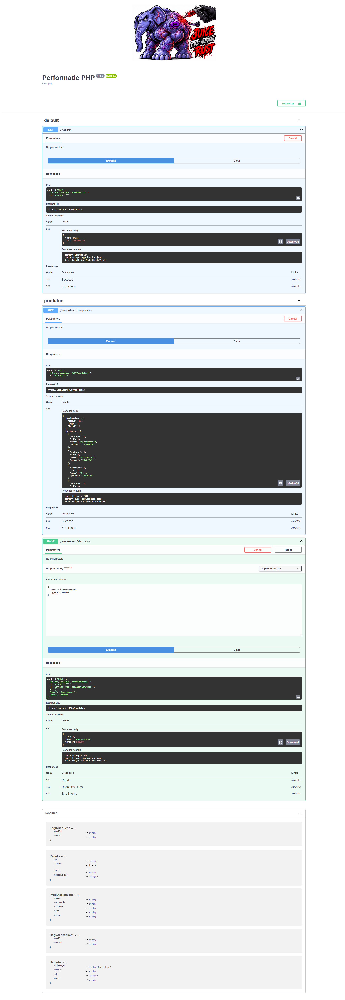
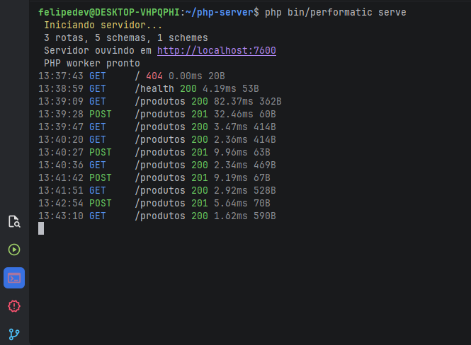

<p align="center">
  
  
  
  
</p>

<h1 align="center">Performatic PHP</h1>

<p align="center">
  <strong>API em PHP procedural. Motor em Rust. Sem Laravel.</strong>
  <br>
  <code>#[Get('/users')]</code> · <code>body()</code> · <code>db()</code> · <code>http(404, ...)</code>
  <br>
  <sub>OpenAPI automático · JWT · PostgreSQL · Cache in-memory · Multipart upload</sub>
</p>

---

## Por que existe

Você já sabe PHP. Você já sabe SQL. Não precisa aprender Eloquent, Blade, Artisan, Facades ou container DI para fazer uma API.

**Performatic PHP** é PHP procedural puro com um motor em Rust. Você escreve funções, o framework cuida do HTTP.

```php
#[Get('/usuarios/{id}')]
function buscar(int $id): string
{
    $user = db_query('SELECT * FROM usuarios WHERE id = ?', [$id]);
    return empty($user) ? http(404, ['erro' => 'não encontrado']) : http(200, $user[0]);
}
```

Isso é tudo. Swagger em `/docs`, JWT em `/login`, cache automático, upload — sem framework pesado.

---

## Instalação

### Docker (recomendado)

```bash
git clone https://github.com/withvisionstack/PERFORMATIC-PHP meu-projeto
cd meu-projeto
cp .env.example .env
docker compose up -d --build
```

Teste:
```bash
curl http://localhost:8000/ping
# {"pong":true,"ts":...}

# Swagger
open http://localhost:8000/docs
```

### VPS (Ubuntu/Debian, sem Docker)

```bash
git clone https://github.com/withvisionstack/PERFORMATIC-PHP meu-projeto
cd meu-projeto
./install.sh
cargo run --release
```

O `install.sh` instala PHP, Rust, dependências do sistema, cria `.env` e compila.

### Requisitos (se instalar manualmente)

- Linux (Ubuntu 22.04+, Debian 12+)
- Rust 1.99
- PHP 8.5.x com `php-dev`, `php-curl`, `php-pgsql` (ou `php-mysql`)
- `libclang-dev`, `build-essential`, `pkg-config`

___NOTA: Windows → use WSL2 com Ubuntu (usando sua IDE Vscode ou JetBrains PHPStorm ou outra para codar) ou Docker Desktop. Build nativo no Windows não é suportado.

---

## Sua primeira rota

Edite `api/routes/produtos.php` (crie se não existir):

```php
<?php

#[Get('/produtos', summary: 'Lista produtos', tags: ['produtos'])]
function listar_produtos(): string
{
    $produtos = db_query('SELECT id, nome, preco FROM produtos LIMIT 20');
    return http(200, ['produtos' => $produtos, 'total' => count($produtos)]);
}
```

Registre no `api/routes.php`:

```php
require_once __DIR__ . '/routes/produtos.php';
```

Crie a tabela:

```bash
docker compose exec postgres psql -U performatic -d performatic -c "
CREATE TABLE produtos (
    id SERIAL PRIMARY KEY,
    nome TEXT NOT NULL,
    preco NUMERIC(10,2) NOT NULL
);
INSERT INTO produtos (nome, preco) VALUES ('Caneta', 2.50), ('Caderno', 15.00);
"
```

Teste:

```bash
curl http://localhost:8000/produtos | jq
# {"produtos":[{"id":1,"nome":"Caneta","preco":"2.50"},{"id":2,"nome":"Caderno","preco":"15.00"}],"total":2}
```

**Pronto.** Swagger em `/docs` já documenta automaticamente.

---

## Sintaxe

### Roteamento

```php
#[Get('/caminho')]              // GET
#[Post('/caminho')]             // POST
#[Put('/caminho')]              // PUT
#[Patch('/caminho')]            // PATCH
#[Delete('/caminho')]           // DELETE

#[Get('/usuarios/{id}')]        // parâmetro de URL
function buscar(int $id): string { /* $id já vem como int */ }
```

### Leitura de request

| Helper | Retorno | Exemplo |
| :--- | :--- | :--- |
| `body()` | `array` | `$dados = body();` |
| `raw_body()` | `string` | `$xml = raw_body();` |
| `method()` | `string` | `if (method() === 'POST')` |
| `query($key, $default)` | `mixed` | `$page = (int) query('page', 1);` |
| `header($name, $default)` | `?string` | `header('User-Agent')` |
| `bearer_token()` | `?string` | `bearer_token()` |
| `current_user()` | `?array` | `current_user()` |

### Segurança Extremamente importante

Estado entre requisições: O worker é persistente. Superglobais são resetadas a cada request, mas static dentro de funções, $GLOBALS customizados e conexões PDO persistem. Não guarde estado de usuário em static — use JWT ou banco


### Escrita de response

| Helper | Status | Uso |
| :--- | :--- | :--- |
| `json_response($array)` | 200 | `return json_response([...]);` |
| `http($status, $array)` | custom | `return http(201, ['id' => 1]);` |
| `http($status, ['erro' => '...'])` | custom | `return http(400, ['erro' => 'inválido']);` |

**Status comuns**: 200, 201, 204, 400, 401, 403, 404, 409, 422, 429, 500.

### Banco de dados

```php
// SELECT (retorna array)
$rows = db_query('SELECT * FROM produtos WHERE preco > ?', [100]);

// INSERT
$pdo = db();
$stmt = $pdo->prepare('INSERT INTO produtos (nome, preco) VALUES (?, ?)');
$stmt->execute(['Caneta', 2.50]);
$id = (int) $pdo->lastInsertId();

// UPDATE
$pdo->prepare('UPDATE produtos SET preco = ? WHERE id = ?')->execute([3.00, $id]);

// DELETE
$pdo->prepare('DELETE FROM produtos WHERE id = ?')->execute([$id]);

// Transação
$pdo->beginTransaction();
try {
    // ...
    $pdo->commit();
} catch (Throwable $e) {
    $pdo->rollBack();
    throw $e;
}
```

### Autenticação JWT

```php
#[Post('/login', tags: ['auth'])]
#[Body('LoginRequest', example: ['email' => 'user@test.com', 'senha' => '123456'])]
#[Response(200, 'Autenticado')]
#[Response(401, 'Credenciais inválidas')]
function login(): string
{
    $dados = body();
    $stmt = db()->prepare('SELECT id, senha_hash FROM usuarios WHERE email = ?');
    $stmt->execute([$dados['email'] ?? '']);
    $user = $stmt->fetch();

    if (!$user || !password_verify($dados['senha'] ?? '', $user['senha_hash'])) {
        return http(401, ['erro' => 'credenciais inválidas']);
    }

    $token = jwt_encode(['user_id' => $user['id'], 'email' => $dados['email']]);
    set_cookie('auth_token', $token, ['expires' => time() + 3600]);

    return http(200, ['token' => $token]);
}

#[Get('/me', tags: ['auth'])]
#[Security('BearerAuth')]
#[Response(200, 'OK')]
#[Response(401, 'Não autenticado')]
function me(): string
{
    $user = current_user();  // funciona com Bearer OU Cookie
    return $user === null ? http(401, ['erro' => 'não autenticado']) : http(200, $user);
}
```

**Cliente SPA/mobile**:
```javascript
fetch('/me', { headers: { Authorization: `Bearer ${token}` } })
```

**Cliente browser** (cookie HttpOnly, sem JS acessível):
```javascript
fetch('/me', { credentials: 'include' })
```

### Upload de arquivos

```php
#[Post('/upload', tags: ['arquivos'])]
#[Response(201, 'Salvo')]
#[Response(413, 'Arquivo grande')]
function upload(): string
{
    $info = file_info('arquivo');
    if ($info === null) return http(400, ['erro' => 'arquivo obrigatório']);
    if ($info['size'] > 2 * 1024 * 1024) return http(413, ['erro' => 'máx 2MB']);

    $path = file_save('arquivo', __DIR__ . '/../storage');
    return http(201, ['path' => basename($path), 'size' => $info['size']]);
}
```

```bash
curl -X POST http://localhost:8000/upload -F "arquivo=@foto.jpg"
```

### HTTP paralelo (API externa)

```php
#[Get('/clima')]
function clima(): string
{
    $urls = [
        'https://api.clima.com/sao-paulo',
        'https://api.clima.com/curitiba',
    ];
    $respostas = http_parallel($urls);  // dispara as 2 em paralelo
    return http(200, ['dados' => array_map('json_decode', $respostas)]);
}
```

---

## OpenAPI automático

Todo endpoint anotado aparece no Swagger em `/docs`.

```php
#[Post('/produtos',
    summary: 'Cria produto',
    description: 'Adiciona um produto ao catálogo',
    tags: ['produtos'])]
#[Body('ProdutoRequest', example: ['nome' => 'Caneta', 'preco' => 2.50])]
#[Response(201, 'Criado', schema: 'Produto')]
#[Response(400, 'Dados inválidos')]
#[Security('BearerAuth')]
function criar(): string { /* ... */ }
```

Schemas em `api/schemas.php`:

```php
#[Schema('ProdutoRequest', [
    'nome'  => 'string',
    'preco' => 'float',
], required: ['nome', 'preco'])]
function __schema_produto_request() {}

#[Schema('Produto', [
    'id'    => 'int',
    'nome'  => 'string',
    'preco' => 'float',
])]
function __schema_produto() {}
```

Security schemes em `api/security.php`:

```php
#[SecurityScheme('BearerAuth', 'http', 'bearer', 'JWT')]
function __security_bearer() {}
```

Acesse `http://localhost:8000/docs` → Swagger UI interativa, com botão "Authorize" e "Try it out".

---

## Estrutura de projeto recomendada

```
meu-projeto/
├── src/                       ← motor Rust (não editar)
├── api/
│   ├── routes/
│   │   ├── auth.php           ← /login, /register, /me
│   │   ├── usuarios.php       ← CRUD usuarios
│   │   ├── produtos.php       ← CRUD produtos
│   │   └── pedidos.php        ← CRUD pedidos
│   ├── routes.php             ← entrypoint (só requires)
│   ├── schemas.php            ← schemas OpenAPI
│   ├── security.php           ← schemes de auth
│   ├── attributes.php         ← #[Get], #[Post], etc (não editar)
│   ├── http.php               ← http_parallel (não editar)
│   ├── cookies.php            ← set_cookie (não editar)
│   ├── jwt.php                ← jwt_encode/decode (não editar)
│   ├── multipart.php          ← upload (não editar)
│   └── db.php                 ← PDO helpers (não editar)
├── db/
│   └── init.sql               ← schema inicial
├── app/
│   └── config.php             ← carrega .env (não editar)
├── storage/                   ← uploads (git-ignored)
├── nginx/
│   └── nginx.conf
├── .env                       ← configuração (git-ignored)
├── .env.example
├── docker-compose.yml
├── Dockerfile
├── Cargo.toml
├── composer.json
└── README.md
```

**Divida por domínio** quando passar de 20 rotas. Cada arquivo em `api/routes/` é independente.

---

## Pacotes recomendados (Packagist)

| Pacote | Uso | Instalação |
| :--- | :--- | :--- |
| **`firebase/php-jwt`** | JWT (já instalado) | `composer require firebase/php-jwt` |
| **`robmorgan/phinx`** | Migrations | `composer require robmorgan/phinx` |
| **`monolog/monolog`** | Logs estruturados | `composer require monolog/monolog` |
| **`ramsey/uuid`** | UUIDs | `composer require ramsey/uuid` |
| **`guzzlehttp/guzzle`** | HTTP client (se não quiser `http_parallel`) | `composer require guzzlehttp/guzzle` |
| **`stripe/stripe-php`** | Pagamentos | `composer require stripe/stripe-php` |
| **`phpmailer/phpmailer`** | E-mail SMTP | `composer require phpmailer/phpmailer` |

**NÃO use**: `illuminate/database` (Eloquent), `doctrine/orm`, `symfony/console`, `laravel/framework` — todos trazem peso e paradigma OOP que contradizem o framework.

---

## Migrations (Phinx)

```bash
composer require robmorgan/phinx
vendor/bin/phinx init
vendor/bin/phinx create CreateProdutos
```

`db/migrations/20260101000000_create_produtos.php`:

```php
<?php
use Phinx\Migration\AbstractMigration;

class CreateProdutos extends AbstractMigration
{
    public function change(): void
    {
        $this->table('produtos')
            ->addColumn('nome', 'string', ['limit' => 200])
            ->addColumn('preco', 'decimal', ['precision' => 10, 'scale' => 2])
            ->addTimestamps()
            ->create();
    }
}
```

```bash
vendor/bin/phinx migrate
```

---

## Deploy em produção

### Docker (recomendado)

```bash
# 1 worker
docker compose up -d --build

# 4 workers (Nginx balanceia)
docker compose up -d --scale api=4
```

O `nginx/nginx.conf` já usa `least_conn` e `resolver 127.0.0.11` (DNS do Docker), então escala automaticamente.

### HTTPS com Certbot

```bash
sudo apt install certbot python3-certbot-nginx
sudo certbot --nginx -d api.seudominio.com
```

### Quantos workers?

| Servidor | Workers | RAM | Throughput estimado |
| :--- | :--- | :--- | :--- |
| 2 vCPU / 2 GB | **2** | ~100 MB | ~2-5k req/s |
| 4 vCPU / 4 GB | **4** | ~200 MB | ~5-10k req/s |
| 8 vCPU / 8 GB | **8** | ~400 MB | ~10-20k req/s |

**Regra**: `N = núcleos da CPU`. Acima disso não ganha throughput (só contenção).

### systemd (sem Docker)

`/etc/systemd/system/performatic@.service`:

```ini
[Unit]
Description=Performatic PHP Worker %i
After=network.target postgresql.service

[Service]
Type=simple
User=www-data
WorkingDirectory=/var/www/api
EnvironmentFile=/var/www/api/.env
Environment="PORT=760%i"
ExecStart=/var/www/api/target/release/php-server
Restart=always
RestartSec=2
LimitNOFILE=65535

[Install]
WantedBy=multi-user.target
```

```bash
sudo systemctl enable --now performatic@{0..3}
```

---

## Performance

Benchmarks em Docker (VPS 4 vCPU / 4 GB):

| Endpoint | Throughput | Cenário |
| :--- | :--- | :--- |
| `GET /ping` | **3.500 req/s** | Via Nginx, 1 worker |
| `GET /ping` (host) | **55.000 req/s** | Sem Docker, sem Nginx |
| `GET /produtos` (DB) | **400 req/s** | Query SELECT com pool PDO |
| `GET /produtos` (cache) | **3.500 req/s** | Cache hit (TTL 60s) |
| `POST /login` (bcrypt) | **~80 req/s** | bcrypt 12 rounds (intencional) |

**Comparação com Laravel + FPM** (mesmo hardware):

| Endpoint | Performatic | Laravel | Ganho |
| :--- | :--- | :--- | :--- |
| `/ping` | 3.500 | 350 | **10×** |
| `/produtos` (DB) | 400 | 150 | **2,7×** |
| `/login` | 80 | 40 | **2×** |

**O gargalo real é o banco, não o framework.** O `eval` do PHP leva ~17μs; o PostgreSQL leva 1-50ms por query.

### Cache in-memory

- Só `GET` é cacheado (nunca POST/PUT/DELETE)
- TTL: 60s (configurável em `CACHE_TTL_SECS`)
- Rotas excluídas: `/me`, `/headers`, `/diag`, `/ini`, `/routes`, `/ping`
- Cache hit retorna em **< 5ms**

---

## Troubleshooting

### `AddrInUse` na porta 7600
```bash
sudo pkill -9 -f php-server
sudo fuser -k 7600/tcp
```


### `vendor/autoload.php not found` no Docker
O `composer install` falhou. Confirme:
```bash
docker compose build --no-cache api 2>&1 | grep "composer OK"
```

### `curl.so not loaded` no embed
Adicione ao `php.ini`:
```ini
extension=curl
extension=pdo_pgsql
```

### `libphp.so not found`
O `ext-php-rs` procura em `/usr/lib/libphp.so`. Confirme:
```bash
docker compose exec api ls -la /usr/lib/libphp*.so*
```

### `/login` retornando 100% non-2xx no `wrk`
Bug conhecido: o `wrk --s /dev/stdin` não envia o `body` corretamente. Salve o script em arquivo:
```bash
cat > /tmp/login.lua <<'EOF'
wrk.method = "POST"
wrk.body   = '{"email":"admin@test.com","senha":"123456"}'
wrk.headers["Content-Type"] = "application/json"
EOF

wrk -t4 -c50 -d15s -s /tmp/login.lua http://localhost:8000/login
```

---

## Licença

MIT. Veja [LICENSE](LICENSE).

## Contribuindo

PRs são bem-vindos. Abra uma issue para features grandes antes de implementar.

---

<p align="center">
  <sub>Feito para quem quer fazer API em PHP sem framework pesado.</sub>
</p>
